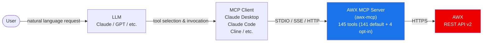

# AWX MCP Server

Connect your MCP client to AWX to inspect failed jobs, read execution logs, and manage automation with the caller’s AWX permissions. Run locally over stdio or share a central server with per-user token passthrough.


[한국어](README.ko.md) | [日本語](README.ja.md)

Git installation is available now. This package is **not on PyPI**. The first release, GHCR image, and MCP Registry publication are pending, so the Release badge may show no release.

## Quick Start

Install uv first: https://docs.astral.sh/uv/

Use your own AWX URL and token. The following read-only setup uses environment variables instead of embedding a token in the command.

```bash
export ANSIBLE_BASE_URL="https://awx.example.com/"
export ANSIBLE_TOKEN="REPLACE_WITH_YOUR_AWX_TOKEN"
export AWX_MCP_READ_ONLY=true
claude mcp add --scope project awx \
  -e 'ANSIBLE_BASE_URL=${ANSIBLE_BASE_URL}' \
  -e 'ANSIBLE_TOKEN=${ANSIBLE_TOKEN}' \
  -e 'AWX_MCP_READ_ONLY=${AWX_MCP_READ_ONLY}' \
  -- uvx --from git+https://github.com/lycorp-jp/awx-mcp awx-mcp
```

`AWX_MCP_READ_ONLY=true` is an optional starting point. Remove it only when you need write tools and your AWX role permits the operation. Let the MCP client launch the server. Claude Desktop and other clients are covered in [MCP Client Integration](#mcp-client-integration).

The single quotes keep `${VAR}` references in `.mcp.json`. Start Claude Code from a shell with those variables set. Environment expansion: https://code.claude.com/docs/en/mcp#environment-variable-expansion-in-mcpjson

## Read-only fixture demo


The GIF shows actual MCP `list_jobs(status="failed")` and `get_job_stdout(job_id=42)` calls against a local fake AWX fixture. All records and the token are synthetic. This is a protocol demonstration, not a live AWX or LLM session.

[Transcript](docs/demo.txt) · [Reproduction recipe](docs/demo.tape)

## Table of Contents

- [Quick Start](#quick-start)
- [Read-only fixture demo](#read-only-fixture-demo)
- [Prerequisites](#prerequisites)
- [Architecture](#architecture)
- [Compatibility](#compatibility)
- [Features](#features)
- [Installation](#installation)
- [Deployment modes](#deployment-modes)
- [Configuration](#configuration)
- [Credential Management (opt-in)](#credential-management-opt-in)
- [MCP Client Integration](#mcp-client-integration)
- [Usage Examples](#usage-examples)
- [Resources and runbook prompts](#resources-and-runbook-prompts)
- [Tools](#tools)
- [Troubleshooting](#troubleshooting)
- [Contributing](#contributing)
- [Code of Conduct](#code-of-conduct)
- [Changelog](#changelog)
- [Security Policy](#security-policy)
- [Star History](#star-history)
- [License](#license)

---

## Prerequisites

- A reachable AWX instance and its base URL (REST API v2), plus an API token (or username + password) with appropriate permissions
- uv: https://docs.astral.sh/uv/ (provides `uvx`, which runs the server straight from the git repo - no clone needed)

---

## Architecture



> The LLM analyzes the user's request, selects the appropriate MCP tool, and the AWX MCP server calls the AWX REST API and returns the result.

> Use stdio for local clients and Streamable HTTP for new remote deployments. SSE is retained as a legacy compatibility transport (`--serve --sse`, `/sse`).

---

## Compatibility

| Component | Supported |
|-----------|-----------|
| AWX | 24.6.1 (REST API v2) |
| Python | ≥ 3.10 |
| MCP transport | STDIO, SSE, Streamable HTTP |
| Server version | `1.0.0`, versioned independently from AWX using SemVer (`MAJOR.MINOR.PATCH`). Breaking public-interface changes increment MAJOR, compatible features increment MINOR, and compatible fixes increment PATCH. Release tags use `vMAJOR.MINOR.PATCH`. No release tag is implied by this development version. |
| Other AWX / Ansible Tower versions | Not verified by this compatibility claim. Validate against your instance before adoption. |

---

## Features

| Capability | Practical benefit |
|------------|-------------------|
| 145 tools across 20 AWX domains | Inspect inventories, jobs, workflows, projects, RBAC, and system state from one MCP client. |
| Local stdio and central `--serve` | Choose a personal process or a shared server using each caller’s own AWX token. |
| `AWX_MCP_READ_ONLY=true` | Expose only read tools at server startup. AWX RBAC still applies. |
| Name filters and pagination | Resolve named resources and limit the number of records returned to the client. |
| Token caching | Reuse server-created OAuth2 tokens when authenticating locally with username and password. |
| TLS and optional file logs | Protect network credentials. Central mode emits per-user usage and HTTP access JSONL to stdout, with optional additional file logs. |

141 tools are enabled by default. 4 credential/user write tools require explicit opt-in. Other tools can still return sensitive inventory variables, job output, or account data. Review [Credential Management](#credential-management-opt-in) and [security guidance](docs/security.md) before enabling writes.

---

## Installation

The supported package source is GitHub. Use the main branch today, or append `@<commit-sha-or-existing-ref>` to select a revision that actually exists. No release tag is promised before the first release.

```bash
uvx --from git+https://github.com/lycorp-jp/awx-mcp awx-mcp
```

`uvx` fetches, builds, and caches the repository. Use `--refresh` once to update the cached main branch. For development: `uv run --directory /path/to/awx-mcp awx-mcp --stdio`. Check the installed version with `awx-mcp --version` in that environment.

### Docker / Podman

Build the container from a local checkout now. The explicit `--stdio` is required here because the image’s default command runs a central HTTP server.

```bash
docker build -t awx-mcp:local .
docker run -i --rm -e ANSIBLE_BASE_URL -e ANSIBLE_TOKEN -e AWX_MCP_READ_ONLY awx-mcp:local --stdio
```

Pass values through your environment. Do not use `-t` for MCP stdio. GHCR and tag-based commands will be documented after the first release is published. For multi-user HTTP, proxy mode, TLS, and replicas, see [deployment](docs/deployment.md).

---

## Deployment modes

| Command | Mode | Authentication |
|---------|------|----------------|
| `awx-mcp` / `awx-mcp --stdio` | Local stdio | Own AWX token, or username/password |
| `awx-mcp --remote <URL>` | Local proxy to a central server | Own AWX token only |
| `awx-mcp --serve` | Central Streamable HTTP server | Each caller’s request token |

The central server ignores static AWX credentials. Protect caller tokens with TLS and restrict network access. `--host` and `--port` override their environment variables. See [deployment examples, direct HTTP, and replica setup](docs/deployment.md) and [TLS and logs](docs/security.md).

### Select toolsets and read-only access

Limit the advertised tools with `--toolsets jobs,job_templates` or `AWX_MCP_TOOLSETS`. The CLI flag overrides the environment. The default is `all`. Unknown names and empty selections fail at startup. In `--serve` mode the selection applies to every caller. In `--remote` mode subsets are rejected, so configure them on the central server instead.

`--read-only` and `AWX_MCP_READ_ONLY=true` are combined with OR. Either enables the restriction. Local and central servers expose only read tools. A proxy forwards `X-AWX-Read-Only: true` to restrict its session. The default still exposes 141 tools, including writes permitted by AWX RBAC.

```bash
awx-mcp --toolsets jobs,job_templates --read-only
```

<!-- TOOLSET_SUMMARY:BEGIN -->
<!-- Generated by scripts/gen_tool_docs.py. Do not edit by hand. -->

| Toolset | Default tools | With credential opt-in |
|---------|---------------|------------------------|
| `ad_hoc` | 3 | 3 |
| `credentials` | 5 | 7 |
| `execution_environments` | 5 | 5 |
| `groups` | 7 | 7 |
| `hosts` | 5 | 5 |
| `instances` | 4 | 4 |
| `inventories` | 14 | 14 |
| `job_templates` | 13 | 13 |
| `jobs` | 7 | 7 |
| `labels` | 2 | 2 |
| `notifications` | 3 | 3 |
| `organizations` | 5 | 5 |
| `projects` | 11 | 11 |
| `rbac` | 7 | 7 |
| `schedules` | 5 | 5 |
| `system` | 9 | 9 |
| `teams` | 5 | 5 |
| `users` | 3 | 5 |
| `workflow_jobs` | 11 | 11 |
| `workflow_templates` | 17 | 17 |
<!-- TOOLSET_SUMMARY:END -->

---

## Configuration

Set AWX connection details via environment variables. Put them directly in the `env` block of your MCP client config.

### Required

| Variable | Description | Example |
|----------|-------------|---------|
| `ANSIBLE_BASE_URL` | AWX instance URL (trailing `/` optional) | `https://awx.example.com` |

### Authentication (choose one)

**Option 1: API token (recommended)**

Use a token generated in the AWX UI. Tokens may expire or be revoked according to AWX policy. Use the least privilege and scope needed, and rotate it when required.

| Variable | Description |
|----------|-------------|
| `ANSIBLE_TOKEN` | Pre-generated API token |

> Generate a token in AWX: User Profile > Tokens > Add. Choose Read scope for read-only use, or Write only when required. AWX RBAC also limits access.

**Option 2: Username + password**

The server automatically creates and caches an OAuth2 token on your behalf.

| Variable | Description |
|----------|-------------|
| `ANSIBLE_USERNAME` | AWX username |
| `ANSIBLE_PASSWORD` | AWX password |

### Optional

| Variable | Default | Description |
|----------|---------|-------------|
| `ANSIBLE_SSL_VERIFY` | `true` | TLS certificate verification (`true`/`false`). Verification is **on by default**. Set to `false` to disable verification (**insecure** - a warning is logged; only for dev/self-signed setups without a CA bundle). |
| `ANSIBLE_CA_BUNDLE` | unset | Path to a custom CA bundle / self-signed certificate (PEM) to trust when verification is enabled. Lets you connect to an AWX instance with a private CA without disabling verification. The server fails fast at startup if the path doesn't exist. |
| `ANSIBLE_LOG_LEVEL` | `INFO` | Log level (`DEBUG`, `INFO`, `WARNING`, `ERROR`) |
| `AWX_HTTP_TIMEOUT_READ` | `90` | Read timeout in seconds for each AWX API request. Raise it if large `get_job_stdout` / `get_job_events` calls time out on a slow AWX. |
| `AWX_MCP_ENABLE_CREDENTIAL_MANAGEMENT` | `false` | Opt-in for the 4 credential/user write tools that collect sensitive data via Form-mode elicitation. See [Credential Management](#credential-management-opt-in). |
| `AWX_MCP_TOOLSETS` | `all` | Comma-separated tool modules. `--toolsets` overrides this value. Server-global with `--serve`. Subsets are rejected with `--remote`. |
| `AWX_MCP_READ_ONLY` | `false` | Read-only mode. On the `--serve` central server, `true` unregisters all write/destructive tools globally (users cannot re-enable). In `--remote` proxy mode, `true` restricts only that user's session (the proxy sends `X-AWX-Read-Only`; the server rejects that caller's write calls). Advisory self-limit - see [Deployment modes](docs/deployment.md). |
| `AWX_MCP_REMOTE_URL` | unset | Central server URL for proxy mode (equivalent to `--remote <URL>`; the flag takes precedence). |
| `AWX_MCP_HOST` | `127.0.0.1` | Bind host for the `--serve` server. Overridden by `--host`. |
| `AWX_MCP_PORT` | `8000` | Bind port for the `--serve` server. Overridden by `--port`. |
| `AWX_MCP_TLS_ENABLE` | `false` | When `true`, the `--serve` server serves HTTPS in-process (uvicorn). Strongly recommended, since caller tokens travel in a request header. |
| `AWX_MCP_TLS_CERT` | unset | Path to the server's TLS certificate (PEM). Required when `AWX_MCP_TLS_ENABLE=true`; the server fails fast at startup if missing or not found. |
| `AWX_MCP_TLS_KEY` | unset | Path to the server's TLS private key (PEM). Required when TLS is enabled. |
| `AWX_MCP_TLS_KEY_PASSWORD` | unset | Password for the private key, if it is encrypted. Optional. |
| `AWX_MCP_STATELESS_HTTP` | `false` | Stateless streamable-http mode: each request is self-contained, with no per-session state held in the process. Needed to run multiple `--serve` replicas behind a plain round-robin load balancer (otherwise a session created on one replica 404s when routed to another). Default off preserves stateful session behavior for single-instance / sse setups. |
| `AWX_MCP_USAGE_LOG_FILE` | unset | Optional rotated JSON Lines usage log file in every mode, including the `--remote` proxy. Each MCP tool call records one JSON document (`@timestamp`, `type`, `user`, `tool`, `params` (redacted call arguments), `trace_id`, `server_version`, `success`, `latency_ms`, `auth_mode`, `transport`, `awx_host`, `error{type,message}` on failure). In central `--serve` mode (`streamable-http` or `sse`), tool and internal API usage records always go to stdout, and this path adds a file sink. Unset disables usage logging only in local stdio and proxy mode. See [Verbose usage logging](docs/security.md#verbose-usage-logging). |
| `AWX_MCP_USAGE_USER` | unset | Optional label used as the `user` field in the proxy's local usage log (proxy mode has no AWX access to resolve a username; defaults to `local`). |
| `AWX_MCP_ACCESS_LOG_FILE` | unset | Optional additional JSON Lines access log file for the `--serve` server. Every inbound HTTP request is recorded to stdout even when this path is unset (client IP, method, path, status, latency). The file rotates at midnight (UTC), same as the usage log. `--serve` mode only - local stdio and the `--remote` proxy have no inbound HTTP socket. |
| `AWX_MCP_SERVER_LOG_FILE` | unset | Path to a server diagnostic log file, mirroring the existing stderr diagnostics and errors. Unset means stderr only, no file. |
| `AWX_MCP_SERVER_LOG_FORMAT` | `plain` | Server diagnostic log format: `plain` or `json`. |
| `AWX_MCP_LOG_BACKUP_COUNT` | `7` | Number of rotated log files to retain. Both log files rotate daily at midnight (UTC) with a date suffix. |

### TLS / certificate verification

TLS verification stays enabled by default. Trust a private CA with `ANSIBLE_CA_BUNDLE`. In `--remote` mode these verification settings apply to the central server, not AWX. Network-exposed central servers need TLS and restricted access. Central `--serve` mode (`streamable-http` or `sse`) always emits usage/access JSONL to stdout. File settings add rotated file logs without disabling stdout. Local stdio and the `--remote` proxy reserve stdout for MCP messages and enable usage file logging only when configured. Diagnostic logs use stderr by default. Container or platform collectors can collect stdout/stderr. See [TLS, log fields, redaction limits, and replica safety](docs/security.md).

---

## Credential Management (opt-in)

4 tools - `create_credential`, `update_credential`, `create_user`, `update_user` - collect passwords or credential inputs through **Form-mode elicitation** and are not registered by default. The remaining tools can still expose sensitive resource data such as job stdout or inventory variables.

To enable them, set:

```bash
AWX_MCP_ENABLE_CREDENTIAL_MANAGEMENT=true
```

Form-mode elicitation is not spec-compliant for sensitive data per the MCP specification - the response may still be exposed through client-side logging or other intermediate systems. Enable only in trusted, isolated environments, and **not** together with `--serve` (a shared network deployment makes this worse than a local stdio process). For the full threat model and disclosure policy, see [SECURITY.md](./SECURITY.md).

---

## MCP Client Integration

### Claude Desktop

Add to `claude_desktop_config.json`:

```json
{
  "mcpServers": {
    "awx": {
      "command": "uvx",
      "args": ["--from", "git+https://github.com/lycorp-jp/awx-mcp", "awx-mcp"],
      "env": {
        "ANSIBLE_BASE_URL": "https://awx.example.com/",
        "ANSIBLE_TOKEN": "your_api_token"
      }
    }
  }
}
```

### Claude Code (CLI)

```bash
claude mcp add awx \
  -e ANSIBLE_BASE_URL=https://awx.example.com/ \
  -e ANSIBLE_TOKEN=your_api_token \
  -- uvx --from git+https://github.com/lycorp-jp/awx-mcp awx-mcp
```

### Cursor

The following install link creates a **read-only template**, not a completed connection. Replace **both** `REPLACE_WITH_YOUR_AWX_HTTPS_URL` and `REPLACE_WITH_YOUR_AWX_TOKEN` in Cursor’s MCP configuration before starting it. Keep that configuration out of version control.

cursor://anysphere.cursor-deeplink/mcp/install?name=awx&config=eyJjb21tYW5kIjoidXZ4IiwiYXJncyI6WyItLWZyb20iLCJnaXQraHR0cHM6Ly9naXRodWIuY29tL2x5Y29ycC1qcC9hd3gtbWNwIiwiYXd4LW1jcCJdLCJlbnYiOnsiQU5TSUJMRV9CQVNFX1VSTCI6IlJFUExBQ0VfV0lUSF9ZT1VSX0FXWF9IVFRQU19VUkwiLCJBTlNJQkxFX1RPS0VOIjoiUkVQTEFDRV9XSVRIX1lPVVJfQVdYX1RPS0VOIiwiQVdYX01DUF9SRUFEX09OTFkiOiJ0cnVlIn19

Official format: https://cursor.com/docs/mcp/install-links

### VS Code (native MCP)

Use `.vscode/mcp.json` or your user MCP configuration. VS Code prompts for the URL and masks the token input. Both `env` references point to the inputs below.

```json
{
  "inputs": [
    {
      "id": "awx-url",
      "type": "promptString",
      "description": "AWX HTTPS base URL"
    },
    {
      "id": "awx-token",
      "type": "promptString",
      "description": "AWX API token",
      "password": true
    }
  ],
  "servers": {
    "awx": {
      "type": "stdio",
      "command": "uvx",
      "args": [
        "--from",
        "git+https://github.com/lycorp-jp/awx-mcp",
        "awx-mcp"
      ],
      "env": {
        "ANSIBLE_BASE_URL": "${input:awx-url}",
        "ANSIBLE_TOKEN": "${input:awx-token}",
        "AWX_MCP_READ_ONLY": "true"
      }
    }
  }
}
```

Configuration reference: https://code.visualstudio.com/docs/agents/reference/mcp-configuration

### Cline (VS Code)

Add to the MCP server config:

```json
{
  "awx": {
    "command": "uvx",
    "args": ["--from", "git+https://github.com/lycorp-jp/awx-mcp", "awx-mcp"],
    "env": {
      "ANSIBLE_BASE_URL": "https://awx.example.com/",
      "ANSIBLE_TOKEN": "your_api_token"
    }
  }
}
```

### Connecting to a central server

Use the stdio proxy or direct Streamable HTTP with your own AWX token. The proxy requires `ANSIBLE_TOKEN` and does not need `ANSIBLE_BASE_URL`. Username/password is local-mode only. See [complete proxy/direct HTTP configurations and TLS requirements](docs/deployment.md).

---

## Usage Examples

Send natural language requests to your MCP client (Claude, etc.) and the server calls the appropriate tools.

### Inventory management

```
"Show me the hosts in the Production inventory"
-> list_hosts(inventory_id=1)

"Add web-server-01 to the Production inventory"
-> create_host(name="web-server-01", inventory_id=1)

"Group the DB servers into a database group"
-> create_group(...) + add_host_to_group(...)
```

### Job execution and monitoring

```
"Run the Deploy App job template"
-> launch_job(template_id=5)

"Check the status of the job I just ran"
-> get_job(job_id=123)

"Show me the job execution log"
-> get_job_stdout(job_id=123)

"Rerun the failed job"
-> relaunch_job(job_id=123)
```

### Projects and SCM

```
"Sync all projects to the latest version"
-> list_projects() + sync_project(project_id=...) for each

"List the playbooks in my-project"
-> list_project_playbooks(project_id=3)
```

### Workflows

```
"Run the deployment workflow and approve it if approval is needed"
-> launch_workflow(template_id=10)
-> list_workflow_approvals() -> approve_workflow(approval_id=...)

"Check which nodes failed in the workflow run"
-> list_workflow_job_nodes(workflow_job_id=50)
```

### RBAC and user management

```
"Grant the developer team read access to the Production inventory"
-> list_object_roles(...) + grant_role_to_team(role_id=..., team_id=...)

"Create a new user john and add them to the DevOps team"
-> create_user(...) + grant_role_to_user(...)
```

### System administration

```
"Check the AWX version and cluster status"
-> get_ansible_version() + list_instances()

"Clean up job records older than 90 days"
-> list_system_job_templates() -> launch_system_job(template_id=..., extra_vars='{"days": 90}')
```

---

## Resources and runbook prompts

Local stdio, central HTTP/SSE, and the stdio proxy expose the same read resources and runbook prompts. Toolset selection also filters these capabilities. Read-only mode keeps them available. Central resource reads use each request's caller token and AWX permissions, with no fallback to server credentials.

Discover the five URI templates through `resources/templates/list`, then substitute an ID obtained from a read tool. `resources/list` is empty because resources are addressed by ID.

| URI template | Content | Required toolset |
|---|---|---|
| `awx://jobs/{id}` | Job details, `application/json` | `jobs` |
| `awx://jobs/{id}/stdout` | Job output, `text/plain` | `jobs` |
| `awx://inventories/{id}` | Inventory details, `application/json` | `inventories` |
| `awx://inventory-sources/{id}` | Inventory source details, `application/json` | `inventories` |
| `awx://projects/{id}` | Project details, `application/json` | `projects` |

Use `prompts/list` and `prompts/get` for these runbooks. Each appears only when all its required toolsets are enabled. Rendering a prompt performs no AWX calls. Its instructions guide read checks and require explicit user confirmation before any write.

| Prompt | Required argument | Read workflow | Required toolsets |
|---|---|---|---|
| `failed_job_triage` | `job_id` | Inspect status, stdout, events and host summaries | `jobs` |
| `pre_change_inventory_check` | `inventory_id` | Verify inventory, hosts, groups and source health | `inventories`, `hosts`, `groups` |
| `project_sync_review` | `project_id` | Review SCM revision, sync history, logs and playbooks | `projects` |

With an initialized Python MCP `ClientSession`:

```python
await session.read_resource("awx://jobs/42/stdout")
await session.get_prompt("failed_job_triage", {"job_id": "42"})
```

The proxy preserves upstream pagination, resource content and metadata. Resource subscriptions and change notifications are not relayed.

## Tools

**145 tools** across 20 modules. By default 141 are registered; the 4 marked **opt-in** below appear only when `AWX_MCP_ENABLE_CREDENTIAL_MANAGEMENT=true` (see [Credential Management](#credential-management-opt-in)).

### Searching by name

Every `list_*` tool over a named collection takes an optional name argument that
AWX applies **server-side** as a case-insensitive partial match. Use it to
resolve a name to an ID in one call instead of paging through the collection:

```
list_job_templates(template_name="deploy")      -> only templates matching "deploy"
list_projects(project_name="platform")          -> only projects matching "platform"
```

The argument is named after the resource (`project_name`, `inventory_name`,
`credential_name`, …); `list_hosts` and `list_instances` use `hostname`, and
`list_users` uses `username`. Omitting it lists everything, as before.

Two collections have no name filter: `list_roles` (AWX derives a role's name from
its role field rather than storing it, so it is not filterable) and the
execution-record listings (`list_jobs`, `list_project_updates`, and similar),
which are queried by status and parent template instead.

<details>
<summary><strong>Show all 145 tools</strong></summary>

<!-- TOOL_TABLES:BEGIN -->
<!-- Generated by scripts/gen_tool_docs.py. Do not edit by hand. -->

### `ad_hoc` (3 tools, 3 default)

| Tool | Access | Summary |
|------|--------|---------|
| `cancel_ad_hoc_command` | Write | Cancel a running AWX ad hoc command. |
| `get_ad_hoc_command` | Read | Get details for one AWX ad hoc command. |
| `run_ad_hoc_command` | Write | Run an AWX ad hoc command. |

### `credentials` (7 tools, 5 default)

| Tool | Access | Summary |
|------|--------|---------|
| `copy_credential` | Write | Copy an AWX credential. |
| `create_credential` | Write (opt-in) | Create an AWX credential. |
| `delete_credential` | Write | Delete an AWX credential. |
| `get_credential` | Read | Get details for one AWX credential. |
| `list_credential_types` | Read | List AWX credential types. |
| `list_credentials` | Read | List AWX credentials. |
| `update_credential` | Write (opt-in) | Update AWX credential metadata or inputs. |

### `execution_environments` (5 tools, 5 default)

| Tool | Access | Summary |
|------|--------|---------|
| `create_execution_environment` | Write | Create an AWX execution environment. |
| `delete_execution_environment` | Write | Delete an AWX execution environment. |
| `get_execution_environment` | Read | Get details for one AWX execution environment. |
| `list_execution_environments` | Read | List AWX execution environments. |
| `update_execution_environment` | Write | Update an AWX execution environment. |

### `groups` (7 tools, 7 default)

| Tool | Access | Summary |
|------|--------|---------|
| `add_host_to_group` | Write | Associate an existing AWX host with a group. |
| `create_group` | Write | Create an AWX group inside an inventory. |
| `delete_group` | Write | Delete an AWX group. |
| `get_group` | Read | Get details for one AWX group. |
| `list_groups` | Read | List AWX inventory groups. |
| `remove_host_from_group` | Write | Remove AWX host membership from a group. |
| `update_group` | Write | Update AWX group metadata and variables. |

### `hosts` (5 tools, 5 default)

| Tool | Access | Summary |
|------|--------|---------|
| `create_host` | Write | Create an AWX host in an inventory. |
| `delete_host` | Write | Delete an AWX host. |
| `get_host` | Read | Get details for one AWX host. |
| `list_hosts` | Read | List AWX hosts. |
| `update_host` | Write | Update AWX host metadata and variables. |

### `instances` (4 tools, 4 default)

| Tool | Access | Summary |
|------|--------|---------|
| `get_instance` | Read | Get details for one AWX cluster instance. |
| `get_instance_group` | Read | Get details for one AWX instance group. |
| `list_instance_groups` | Read | List AWX instance groups. |
| `list_instances` | Read | List AWX cluster instances. |

### `inventories` (14 tools, 14 default)

| Tool | Access | Summary |
|------|--------|---------|
| `cancel_inventory_update` | Write | Cancel a running AWX inventory update. |
| `create_inventory` | Write | Create an AWX inventory in an organization. |
| `create_inventory_source` | Write | Create an AWX inventory source for dynamic host sync. |
| `delete_inventory` | Write | Delete an AWX inventory. |
| `delete_inventory_source` | Write | Delete an AWX inventory source. |
| `get_inventory` | Read | Get details for one AWX inventory. |
| `get_inventory_source` | Read | Get details for one AWX inventory source. |
| `get_inventory_update` | Read | Get details for one AWX inventory update. |
| `list_inventories` | Read | List AWX inventories. |
| `list_inventory_sources` | Read | List AWX inventory sources. |
| `list_inventory_updates` | Read | List AWX inventory source sync history. |
| `sync_inventory_source` | Write | Start an AWX inventory source sync. |
| `update_inventory` | Write | Update AWX inventory metadata. |
| `update_inventory_source` | Write | Update an existing AWX inventory source. |

### `job_templates` (13 tools, 13 default)

| Tool | Access | Summary |
|------|--------|---------|
| `associate_credential_with_template` | Write | Associate a credential with an AWX job template. |
| `copy_job_template` | Write | Create a copy of an AWX job template. |
| `create_job_template` | Write | Create an AWX job template for single playbook execution. |
| `delete_job_template` | Write | Delete an AWX job template. |
| `delete_job_template_survey` | Write | Delete the survey spec from an AWX job template. |
| `disassociate_credential_from_template` | Write | Disassociate a credential from an AWX job template. |
| `get_job_template` | Read | Get details for a specific AWX job template. |
| `get_job_template_survey` | Read | Get the survey spec for an AWX job template. |
| `launch_job` | Write | Launch a single AWX playbook execution from a job template. |
| `list_job_templates` | Read | List AWX job templates for single playbook executions. |
| `list_template_credentials` | Read | List credentials attached to an AWX job template. |
| `set_job_template_survey` | Write | Set the survey spec for an AWX job template. |
| `update_job_template` | Write | Update an existing AWX job template. |

### `jobs` (7 tools, 7 default)

| Tool | Access | Summary |
|------|--------|---------|
| `cancel_job` | Write | Cancel a running AWX regular playbook job. |
| `get_job` | Read | Get details for a single AWX playbook execution job. |
| `get_job_events` | Read | Get event stream records for a specific AWX regular job. |
| `get_job_host_summaries` | Read | Get AWX per-host result summaries for a regular playbook job. |
| `get_job_stdout` | Read | Get stdout logs for a specific AWX regular playbook job. |
| `list_jobs` | Read | List AWX regular playbook jobs, optionally filtered by status. |
| `relaunch_job` | Write | Relaunch a completed or failed AWX regular playbook job. |

### `labels` (2 tools, 2 default)

| Tool | Access | Summary |
|------|--------|---------|
| `create_label` | Write | Create an AWX label in an organization. |
| `list_labels` | Read | List AWX labels. |

### `notifications` (3 tools, 3 default)

| Tool | Access | Summary |
|------|--------|---------|
| `get_notification_template` | Read | Get details for one AWX notification template. |
| `list_notification_templates` | Read | List AWX notification templates. |
| `test_notification_template` | Write | Send a test event through an AWX notification template. |

### `organizations` (5 tools, 5 default)

| Tool | Access | Summary |
|------|--------|---------|
| `create_organization` | Write | Create an AWX organization. |
| `delete_organization` | Write | Delete an AWX organization. |
| `get_organization` | Read | Get details for one AWX organization. |
| `list_organizations` | Read | List AWX organizations. |
| `update_organization` | Write | Update an AWX organization. |

### `projects` (11 tools, 11 default)

| Tool | Access | Summary |
|------|--------|---------|
| `cancel_project_update` | Write | Cancel a running AWX project update. |
| `create_project` | Write | Create an AWX project for playbook content. |
| `delete_project` | Write | Delete an AWX project. |
| `get_project` | Read | Get details for one AWX project. |
| `get_project_update` | Read | Get details for one AWX project update. |
| `get_project_update_stdout` | Read | Get AWX stdout logs for a project update. |
| `list_project_playbooks` | Read | List AWX playbooks discovered in a project. |
| `list_project_updates` | Read | List AWX project SCM sync history. |
| `list_projects` | Read | List AWX projects. |
| `sync_project` | Write | Start an AWX project SCM sync. |
| `update_project` | Write | Update AWX project metadata and SCM settings. |

### `rbac` (7 tools, 7 default)

| Tool | Access | Summary |
|------|--------|---------|
| `get_role` | Read | Get details for one AWX RBAC role. |
| `grant_role_to_team` | Write | Grant an AWX role to a team. |
| `grant_role_to_user` | Write | Grant an AWX role to a user. |
| `list_object_roles` | Read | List AWX RBAC roles for one specific resource. |
| `list_roles` | Read | List all AWX RBAC roles. |
| `revoke_role_from_team` | Write | Revoke an AWX role from a team. |
| `revoke_role_from_user` | Write | Revoke an AWX role from a user. |

### `schedules` (5 tools, 5 default)

| Tool | Access | Summary |
|------|--------|---------|
| `create_schedule` | Write | Create an AWX schedule for recurring launches. |
| `delete_schedule` | Write | Delete an AWX schedule. |
| `get_schedule` | Read | Get details for one AWX schedule. |
| `list_schedules` | Read | List AWX schedules, optionally filtered by template. |
| `update_schedule` | Write | Update an AWX schedule. |

### `system` (9 tools, 9 default)

| Tool | Access | Summary |
|------|--------|---------|
| `get_ansible_version` | Read | Get AWX/Ansible controller version and health information. |
| `get_config` | Read | Get AWX instance configuration metadata. |
| `get_dashboard_stats` | Read | Get AWX dashboard summary statistics. |
| `get_system_job` | Read | Get details for a specific AWX maintenance system job run. |
| `get_system_job_template` | Read | Get details for a specific AWX system job template. |
| `launch_system_job` | Write | Launch an AWX maintenance system job from a system job template. |
| `list_activity_stream` | Read | List AWX activity stream audit entries. |
| `list_system_job_templates` | Read | List AWX system job templates for maintenance operations. |
| `list_system_jobs` | Read | List AWX system job executions. |

### `teams` (5 tools, 5 default)

| Tool | Access | Summary |
|------|--------|---------|
| `create_team` | Write | Create an AWX team within an organization. |
| `delete_team` | Write | Delete an AWX team. |
| `get_team` | Read | Get details for one AWX team. |
| `list_teams` | Read | List AWX teams, optionally scoped to an organization. |
| `update_team` | Write | Update an AWX team. |

### `users` (5 tools, 3 default)

| Tool | Access | Summary |
|------|--------|---------|
| `create_user` | Write (opt-in) | Create an AWX user account. |
| `delete_user` | Write | Delete an AWX user account. |
| `get_user` | Read | Get details for one AWX user. |
| `list_users` | Read | List AWX users. |
| `update_user` | Write (opt-in) | Update an AWX user account. |

### `workflow_jobs` (11 tools, 11 default)

| Tool | Access | Summary |
|------|--------|---------|
| `approve_workflow` | Write | Approve a pending AWX workflow approval request. |
| `cancel_workflow_job` | Write | Cancel a running AWX workflow orchestration run. |
| `deny_workflow` | Write | Deny a pending AWX workflow approval request. |
| `get_workflow_approval` | Read | Get details for a specific AWX workflow approval request. |
| `get_workflow_approval_template` | Read | Get a workflow job template node by ID (may or may not be an approval node). |
| `get_workflow_job` | Read | Get details for a single AWX workflow orchestration run. |
| `list_workflow_approval_templates` | Read | List AWX workflow approval template nodes. |
| `list_workflow_approvals` | Read | List AWX workflow approval requests, optionally filtered by status. |
| `list_workflow_job_nodes` | Read | List node outcomes for an executed AWX workflow job. |
| `list_workflow_jobs` | Read | List AWX workflow orchestration runs, optionally filtered by status. |
| `relaunch_workflow_job` | Write | Relaunch a completed or failed AWX workflow orchestration run. |

### `workflow_templates` (17 tools, 17 default)

| Tool | Access | Summary |
|------|--------|---------|
| `add_workflow_node_always_link` | Write | Add an AWX workflow always-run edge between template nodes. |
| `add_workflow_node_failure_link` | Write | Add an AWX workflow failure edge between template nodes. |
| `add_workflow_node_success_link` | Write | Add an AWX workflow success edge between template nodes. |
| `copy_workflow_template` | Write | Create a copy of an AWX workflow template. |
| `create_workflow_template` | Write | Create an AWX workflow template for multi-step orchestration. |
| `create_workflow_template_node` | Write | Create a node in an AWX workflow template. |
| `delete_workflow_template` | Write | Delete an AWX workflow template. |
| `delete_workflow_template_node` | Write | Delete an AWX workflow template node. |
| `delete_workflow_template_survey` | Write | Delete the survey spec from an AWX workflow template. |
| `get_workflow_template` | Read | Get details for a specific AWX workflow template. |
| `get_workflow_template_node` | Read | Get details for a specific AWX workflow template node. |
| `get_workflow_template_survey` | Read | Get the survey spec for an AWX workflow template. |
| `launch_workflow` | Write | Launch an AWX multi-step workflow from a workflow template. |
| `list_workflow_template_nodes` | Read | List nodes defined in an AWX workflow template. |
| `list_workflow_templates` | Read | List AWX workflow templates for multi-step orchestration. |
| `set_workflow_template_survey` | Write | Set the survey spec for an AWX workflow template. |
| `update_workflow_template` | Write | Update an existing AWX workflow template. |
<!-- TOOL_TABLES:END -->

</details>

---

## Troubleshooting

### Server won't start

**`ValueError: ANSIBLE_BASE_URL environment variable is required`**

The environment variable isn't set. Add `ANSIBLE_BASE_URL` to the `env` block in your MCP client config.

**`ValueError: Authentication is required`**

You need to set either `ANSIBLE_TOKEN` or both `ANSIBLE_USERNAME` and `ANSIBLE_PASSWORD`.

### Connection problems

**SSL certificate error**

TLS verification is on by default. If your AWX instance uses a certificate from a private/internal CA or a self-signed certificate, set `ANSIBLE_CA_BUNDLE` to the CA/certificate's PEM file path - this keeps verification enabled while trusting it. Only as a last resort (e.g. you can't obtain the CA certificate), set `ANSIBLE_SSL_VERIFY` to `"false"` (the string, not a boolean); this disables verification entirely and the server logs a warning. See [TLS verification](docs/security.md#tls--certificate-verification) for details.

**Connection refused / timeout**

- Verify `ANSIBLE_BASE_URL` is correct
- Confirm the AWX instance is running
- Check firewall and network settings

### MCP schema error

**`Does not adhere to MCP server configuration schema`**

All values in the `env` block must be **strings**. Use `"false"` instead of `false`.

### Permission errors

**403 Forbidden**

The API token or user account doesn't have permission for that resource. Ask your AWX administrator to assign the appropriate role.

### Debugging

Set the log level to `DEBUG` to see detailed API request and response logs:

```json
"ANSIBLE_LOG_LEVEL": "DEBUG"
```

---

## Contributing

Contributions are welcome. Please read [CONTRIBUTING.md](CONTRIBUTING.md) for guidelines on how to submit issues, propose changes, and open pull requests.

## Code of Conduct

This project follows the [Code of Conduct](CODE_OF_CONDUCT.md). By participating you agree to abide by its terms.

## Changelog

See [CHANGELOG.md](CHANGELOG.md) for a history of notable changes.

## Security Policy

For vulnerability disclosure, the threat model, and security history, see [SECURITY.md](SECURITY.md).

---

## Star History

<a href="https://www.star-history.com/?repos=lycorp-jp%2Fawx-mcp&amp;type=date&amp;legend=top-left">
  <picture>
    <source media="(prefers-color-scheme: dark)" srcset="https://api.star-history.com/svg?repos=lycorp-jp/awx-mcp&amp;type=Date&amp;legend=top-left&amp;theme=dark" />
    <source media="(prefers-color-scheme: light)" srcset="https://api.star-history.com/svg?repos=lycorp-jp/awx-mcp&amp;type=Date&amp;legend=top-left" />
    
  </picture>
</a>

---

## License

Apache License 2.0. See [LICENSE](LICENSE) for details.
